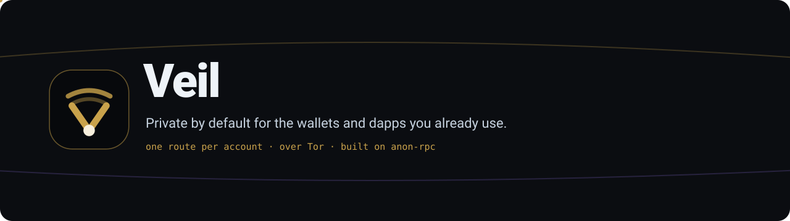
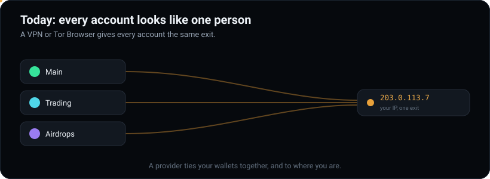
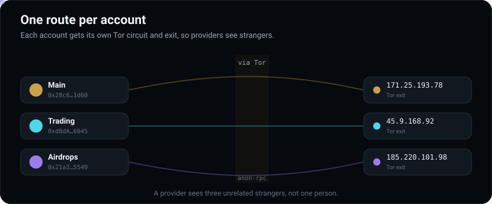
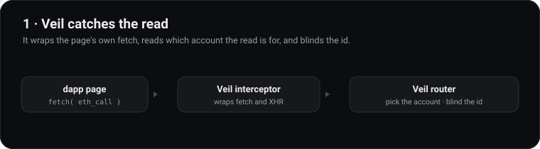
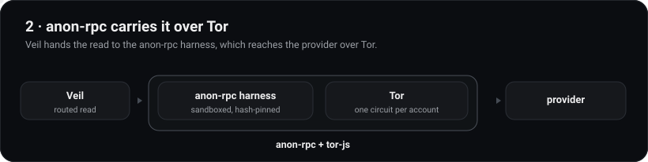
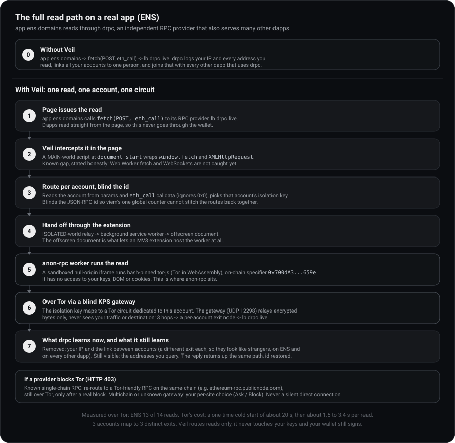

<p align="center">
  
</p>

<p align="center">
  <b>anon-rpc, adopted by you, not by the app.</b>
  <br/>
  Instead of waiting for every dapp and wallet to integrate privacy, you turn Veil on once and get
  private reads across all the apps you already use, with <b>one route per account</b> over Tor.
  <br/><br/>
  Built on the Ethereum Foundation's <a href="https://github.com/ethereum/anon-rpc">anon-rpc</a> and <a href="https://github.com/ethereum/tor-js">tor-js</a>.
  <br/>
  <b>🌐 <a href="https://aman035.github.io/veil/">Live demo</a></b>
</p>

---

## 1. The problem

Wallets and dapps read mostly **straight from the page** to their data providers (Tenderly,
Alchemy, their own backends). Every read carries **your IP** and **the addresses you look up**.
A provider can tie your main wallet, trading wallet and airdrop wallets to **one person**, and
to **where you are**. That is how holders get de-anonymised, phished and physically targeted.

The usual fixes don't solve it:

- A **VPN** gives all your accounts one IP, so they still look like one person.
- **Tor Browser** isolates circuits per site, not per account, so every account you use on one
  dapp still shares an exit, and many providers block Tor outright (Aave's provider blocked all 16
  of our test reads).
- **Waiting for the app** to adopt anon-rpc or another privacy standard leaves you exposed until it
  does, and only a couple of apps have, all opt-in. You carry the risk while you wait.

<p align="center">
  
</p>

## 2. The solution

Veil makes the wallets and dapps you **already use** private, with no change to them.

> **The real fix is every app adopting anon-rpc. Until they do, you shouldn't pay with your privacy.**
> Only a couple of apps have integrated it, all opt-in. Veil flips the model: instead of each app
> adopting anon-rpc for you, **you adopt it yourself**, turn it on once, and every wallet and dapp you
> already use gets private reads today, with nothing for them to change.

<p align="center">
  
</p>

- **One route per account.** Each account gets its own Tor circuit and exit (an anon-rpc
  isolation key), so a provider sees unrelated strangers instead of one person.
- **Re-routes around blocks.** When a provider refuses Tor, standard reads are re-sent through a
  Tor-friendly provider on the same chain, only after a real block, never blindly.
- **Never silently direct.** If a read can't be made private, Veil asks you, per site, before any
  direct connection.

It ships in two parts: a **browser extension** (Chrome / Brave) that makes every dapp read
private, and an optional **desktop app** that also covers the wallet's own traffic and local
tools like `cast`, and pairs with the extension.

**Honest about what it hides:**

| | Hidden from providers | Still visible |
|---|---|---|
| **Your IP** | yes, on dapp reads and local tools | wallet's own opaque traffic is a planned next step (see Scope); the Tor gateway sees you use Tor, not what for |
| **Accounts linked** | yes, one route per account for RPC traffic | wallets' own multi-account APIs still link them at the app layer |
| **Addresses you query** | no | providers see them; hiding that needs PIR, a separate problem |

## 3. How it works

The extension intercepts a dapp page's JSON-RPC reads, routes each to its account's Tor circuit
through the anon-rpc harness, and returns the answer. The anon-client code runs **hash-pinned
and sandboxed** (anon-rpc) with no access to your keys, DOM or cookies. The desktop app runs the
same harness for the wallet's own traffic and for local tools.

<p align="center">
  
</p>

<p align="center">
  
</p>

Three rules shape every request:

1. **One route per account.** The account is read from the request, even inside `eth_call` call
   data, and request ids are blinded so a counter can't stitch routes back together.
2. **Re-routes around blocks.** Only after a real block, and only for known single-chain RPCs, so
   it never blindly breaks a multichain gateway.
3. **Never silently direct.** Any read that can't be made private surfaces a per-site choice.

**Built on anon-rpc.** Veil routes its RPC reads through anon-rpc **by default**. The extension
runs [`@anon-rpc/browser-extension-harness`](https://www.npmjs.com/package/@anon-rpc/browser-extension-harness) and the helper runs [`@anon-rpc/browser-harness`](https://www.npmjs.com/package/@anon-rpc/browser-harness). With protection on, essentially all of a dapp page's JSON-RPC reads leave through
anon-rpc. We intentionally **don't hide which addresses you look up** (that needs PIR, a separate
problem), which is a stated trade-off, not a gap.

### How the interception works

At `document_start`, before any of the page's own scripts run, Veil installs a MAIN-world shim that
wraps `window.fetch` and `XMLHttpRequest`. Every dapp read goes through one of those, so a single hook
covers viem, ethers v5 and v6, and raw XHR with no per-library integration. For each call Veil:

1. parses the JSON-RPC body (anything that is not a JSON-RPC request passes straight through, untouched);
2. finds the account the read is for, from the params or from inside `eth_call` calldata, ignoring the
   zero address;
3. picks that account's isolation key and blinds the request id (viem numbers requests with one global
   counter, so leaving ids as-is would let a provider stitch the per-account routes back together);
4. relays it through the extension (MAIN world -> ISOLATED-world relay -> background service worker ->
   offscreen anon-rpc worker) and returns the provider's reply to the page unchanged.

### Scope and what's next

Today Veil makes **dapp reads** private per account (the main leak, since dapps read straight from
the page) and gives **local tools** (`cast`, scripts) the same per-account reads through the helper.
With protection on, essentially all of a page's JSON-RPC reads leave through anon-rpc. Two things are
deliberately next, and in both, nothing is ever silently sent in the clear:

- **A couple of read channels aren't wrapped yet.** Reads from a Web Worker's `fetch` or over a
  WebSocket bypass the `fetch`/XHR shim, so they are not routed (not silently downgraded, just not
  covered). Wrapping the `WebSocket` constructor closes most of it; Web Worker scopes need the shim
  injected per worker.
- **The wallet's own opaque HTTPS traffic.** anon-rpc exposes an anonymised `fetch`, not raw TCP
  tunnels, so this needs either a raw-stream capability upstream (the tor-js gateway already supports
  `CONNECT`; the harness doesn't expose it yet) or a local Tor tunnel (hides the IP but can't split
  per account). The extension's `chrome.proxy` hook for this is built but stays **inert** until one
  lands.

<details>
<summary><b>See the full read path on a real app (ENS), with and without Veil</b></summary>

<br/>

<p align="center">
  
</p>

ENS reads through an independent RPC provider (drpc), which also serves many other dapps, so it is a clean
example of the cross-dapp linkage Veil breaks. The diagram is honest about the limit: the provider still
sees the addresses you query, only your IP and the link between your accounts are removed.

</details>

## 4. CROPS

_Censorship-resistant, Open-source, Private, Secure - the properties Veil is built to hold at once._

- **C - Censorship resistant.** There is **no Veil server in the path**. The extension, helper and
  gateway are all things you run; the Tor gateway is **self-hostable and swappable**, and the
  Tor-friendly provider list is user-editable. If our gateway or any provider disappears or
  refuses you, point at another, or run your own, in **one config line**; nothing we operate can
  cut you off. The anon-client worker is fetched at runtime but **hash-pinned on-chain** and
  verified before it runs, so no host can swap in different code.
- **O - Open source.** **MIT.** The extension, helper and app build and run from this repo alone
  (`pnpm install && node build.mjs`); no hidden service is required to use it.
- **P - Private.** RPC providers see the addresses you query but **not your IP**, and **cannot link
  your accounts** (one circuit each). The **gateway relays only encrypted bytes** and never sees
  your traffic or destination. **No analytics, no telemetry, no accounts.** The honest limits are
  in the table above.
- **S - Secure.** Veil **never touches your keys** - it routes reads only; your wallet signs. The
  anon-client runs in a **null-origin sandboxed iframe** with no access to keys, DOM or cookies.
  Settings stay on your device (`chrome.storage` / local app). Trust assumptions: the open-source
  code, the on-chain-hash-pinned worker, and one bootstrap RPC read for the anon-rpc specifier.

No third-party trackers or analytics ship in the client, and Veil handles no keys or personal
data; everything stays on your device.

## 5. Project structure and setting up locally

```
veil/
├── src/        browser extension (Chrome / Brave, MV3)
├── helper/     desktop helper (localhost RPC routed through the harness)
├── app/        desktop app (Tauri) that runs the helper and pairs the extension
└── site/       landing site (published to GitHub Pages)
```

Prereqs: Node 18+ and `pnpm`. The desktop app also needs Rust + Tauri; the real-Tor demo needs a tor-js gateway.

```bash
# 1) Browser extension  (to actually route, build with a network - see below)
pnpm install
node build.mjs                 # -> dist/  (load unpacked at chrome://extensions)

# 2) Desktop helper (private localhost RPC for cast / scripts / wallets)
cd helper && pnpm install && node helper.mjs      # serves http://127.0.0.1:18545

# 3) Desktop app (optional): spawns the helper, shows status, pairs the extension
cd app/src-tauri && cargo tauri dev
```

**Choose a network at build time.** The gateway and worker are config, not code, baked in by
`build.mjs`. A bare `node build.mjs` uses a built-in default gateway that is **not guaranteed to be
up** (public demo gateways come and go), and the extension will sit on "Connecting privately…" if it
can't reach one. For anything you rely on, always build with one of the two explicit paths below.

**A) Real Tor via a self-hosted gateway** (the path to demo). Build
[`tor-js-gateway`](https://github.com/ethereum/tor-js), run it, then build the extension against it:

```bash
VEIL_SPECIFIER=0x700dA3193D35fA54Cd3fBf29B66f2a2A0385659e \
VEIL_GATEWAYS='["127.0.0.1:12298:<your-gateway-certhash>"]' \
node build.mjs
```

The gateway prints its `<your-gateway-certhash>` on startup. Keep it running while you demo.

**B) No gateway, deterministic plumbing demo.** Build with the `passthrough` specifier (no Tor, not
private, labelled as such) when you just want to show the interception and routing pipeline:

```bash
VEIL_SPECIFIER=0x4fd77be300f31c5fe6ab266d35d27750a3478d27 VEIL_GATEWAYS='[]' node build.mjs
```

### Run it for a demo (no store or developer account needed)

- **Extension:** build with a network chosen (path A or B above, not a bare `node build.mjs`), then
  open `chrome://extensions`, enable Developer mode, click **Load unpacked**, and pick `dist/`. For a
  live pitch, use path A with your gateway running, and lead with an app that serves Tor (Lido, ENS,
  Compound) so the per-account flow is clean; Aave is the one re-route beat (its provider blocks Tor,
  so Veil re-routes it).
- **Desktop app:** `cd app/src-tauri && cargo tauri dev` (or build an unsigned bundle and open it
  with right-click then Open on macOS). Signed installers and store listings are a later, optional
  step; you don't need a Chrome Web Store or Apple Developer account to run or demo Veil.

## License

[MIT](LICENSE). Built on the Ethereum Foundation's
[anon-rpc](https://github.com/ethereum/anon-rpc) and [tor-js](https://github.com/ethereum/tor-js).
