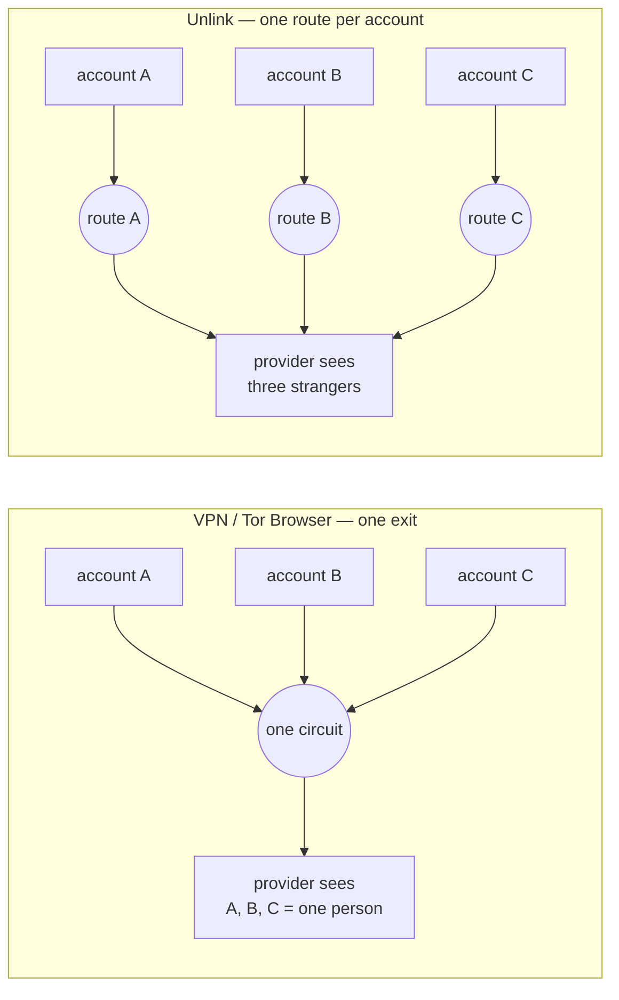
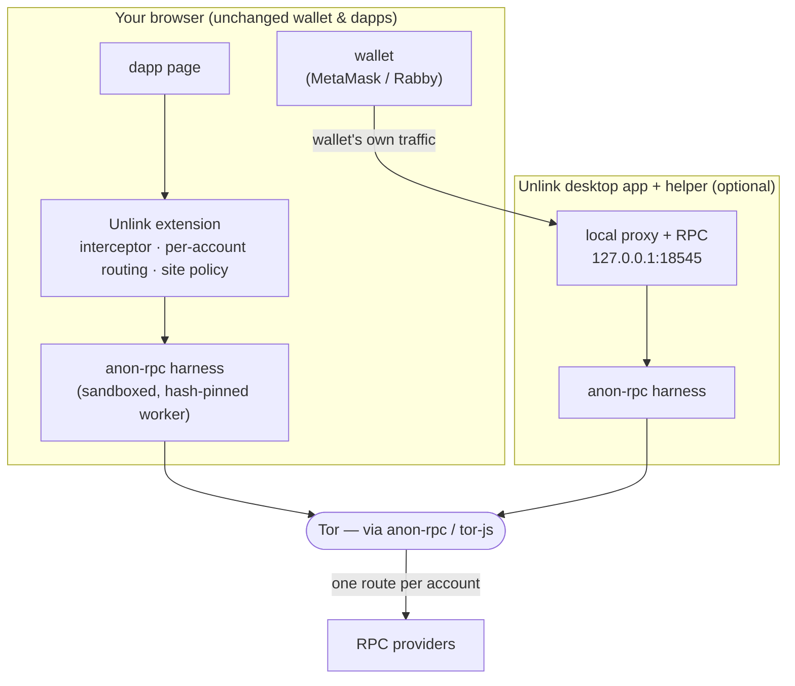
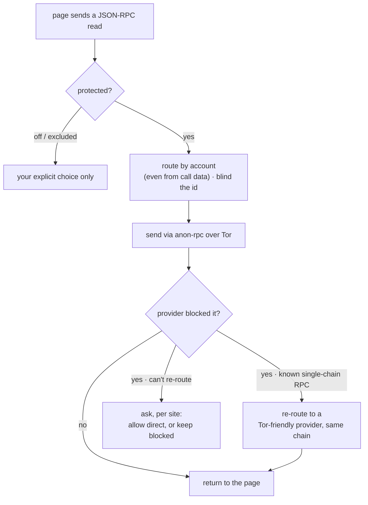

<div align="center">

# 🔗 Unlink

### Private by default for the wallets and dapps you already use.

Unlink routes your crypto traffic through **Tor** with **one route per account**, so the
providers your wallet and dapps talk to can't see your IP or tell your accounts apart —
and it **re-routes around providers that block Tor**, so your apps keep working.

Built on the Ethereum Foundation's **[anon-rpc](https://github.com/ethereum/anon-rpc)** + **[tor-js](https://github.com/ethereum/tor-js)**.

**🌐 [aman035.github.io/unlink](https://aman035.github.io/unlink/)** · _status: active development_

</div>

---

## The problem

Wallets and dapps read mostly **straight from the page** to their data providers (Tenderly,
Alchemy, their own backends). Every read carries **your IP** and **the addresses you look up**.
A provider can tie your main wallet, trading wallet and airdrop wallets to **one person**, and
to **where you are**. A VPN gives all your accounts one IP; Tor Browser gives them one circuit —
neither _unlinks_ accounts, and some providers block Tor outright (Aave's rejected **0/16** reads).



## How it works

Each account is assigned its own **anon-rpc isolation key** → its own Tor circuit and exit, so a
provider sees unrelated strangers instead of one person. Account-agnostic reads share a neutral
route. The anon-client code runs **hash-pinned and sandboxed** (anon-rpc §6), with no access to
your keys, DOM or cookies.



**Three rules shape every request:**



1. **One route per account** — the account is read from the request (even inside `eth_call` call
   data), and request ids are blinded so a counter can't stitch routes back together.
2. **Re-routes around blocks** — only after a real block, and only for known single-chain RPCs.
3. **Never silently direct** — if a read can't be made private, Unlink asks you, per site, first.

## Built on Anon-RPC

Unlink **routes its RPC reads through anon-rpc by default** — that's the whole point, not a toggle.

- The **browser extension** runs [`@anon-rpc/browser-extension-harness`](https://www.npmjs.com/package/@anon-rpc/browser-extension-harness) (tor-js worker in an MV3 offscreen document) and sends every intercepted dapp read through it.
- The **desktop helper** runs [`@anon-rpc/browser-harness`](https://www.npmjs.com/package/@anon-rpc/browser-harness) to give the wallet and local tools (`cast`, scripts) the same private reads.
- Per-account **isolation keys** are what make "one route per account" real; **request-id blinding** keeps viem's global counter from re-linking routes.

**Coverage & trade-offs (honest):** with protection on, essentially all of a dapp page's
JSON-RPC reads leave through anon-rpc. We **intentionally don't hide _which_ addresses you look
up** — that needs PIR, a separate problem — so that's a stated anonymity/performance trade-off,
not a gap. Known gaps: Web-Worker `fetch` and WebSockets aren't intercepted yet.

## What's in this repo

| Path | What it is |
|------|------------|
| [`src/`](src/) | The browser extension (Chrome / Brave, MV3). |
| [`helper/`](helper/) | The desktop helper — localhost RPC routed through the harness. |
| [`app/`](app/) | The desktop app (Tauri) — UI that runs the helper and pairs with the extension. |
| [`site/`](site/) | The landing site (published to GitHub Pages). |

## Run it

Prereqs: Node 18+ and `pnpm`. (Desktop app also needs Rust + Tauri; real-Tor demo needs the tor-js gateway.)

```bash
# 1) Browser extension
pnpm install
node build.mjs                 # → dist/  (load unpacked in chrome://extensions)

# 2) Desktop helper (private localhost RPC for cast / scripts / wallets)
cd helper && pnpm install && node helper.mjs      # serves http://127.0.0.1:18545

# 3) Desktop app (optional) — spawns the helper, shows status, pairs the extension
cd app/src-tauri && cargo tauri dev
```

**Real Tor via a self-hosted gateway** (the EF demo gateway is intermittent, so Unlink lets you
point at any gateway). Build [`tor-js-gateway`](https://github.com/ethereum/tor-js), run it, then build the extension against it:

```bash
UNLINK_SPECIFIER=0x700dA3193D35fA54Cd3fBf29B66f2a2A0385659e \
UNLINK_GATEWAYS='["127.0.0.1:12298:<your-gateway-certhash>"]' \
node build.mjs
```

Without a gateway, build with the `passthrough` specifier for a deterministic (non-private)
plumbing demo. The network is fully swappable — gateway and worker are config, not code.

## What it hides — and what it doesn't

| | Hidden from providers | Still visible |
|---|---|---|
| **Your IP** | ✅ dapp reads (and wallet traffic with the helper) | the Tor gateway sees you use Tor, not what for |
| **Accounts linked** | ✅ one route per account, for RPC traffic | wallets' own multi-account APIs still link them at the app layer |
| **Addresses you query** | ❌ | providers see them — needs PIR (out of scope) |

## CROPS

_Censorship-resistant, Open-source, Private, Secure — the properties Unlink is built to hold at once._

- **C — Censorship resistant.** There is **no Unlink server in the path**. The extension, helper and
  gateway are all things you run; the Tor gateway is **self-hostable and swappable** and the
  Tor-friendly provider list is user-editable. If our demo gateway or any provider disappears or
  refuses you, point at another — or run your own — in **one config line**; nothing we operate can
  cut you off. (The anon-client worker is fetched at runtime but **hash-pinned on-chain** and
  verified before it runs, so no host can swap in different code.)
- **O — Open source.** **MIT / Apache-2.0.** The extension, helper and app build and run from this
  repo alone (`pnpm install && node build.mjs`); no hidden service is required to use it.
- **P — Private.** RPC providers see the addresses you query but **not your IP**, and **cannot link
  your accounts** (one circuit each). The **gateway relays only encrypted bytes** — it never sees
  your traffic or destination. **No analytics, no telemetry, no accounts.** The honest limits are in
  the table above.
- **S — Secure.** Unlink **never touches your keys** — it routes *reads* only; your wallet signs.
  The anon-client runs in a **null-origin sandboxed iframe** with no access to keys, DOM or cookies.
  Settings stay on your device (`chrome.storage` / local app). Trust assumptions: the open-source
  extension code, the on-chain-hash-pinned worker, and one bootstrap RPC read for the anon-rpc
  specifier.

**No third-party trackers or analytics** ship in the client, and Unlink handles no keys or personal
data — everything stays on your device.

## Demo

📹 _Demo video: coming soon (≤ 3 min — toggle on, three accounts on three exits, a provider block re-routed, the "allow direct?" choice)._

## License

MIT or Apache-2.0, at your option. Built on the Ethereum Foundation's
[anon-rpc](https://github.com/ethereum/anon-rpc) and [tor-js](https://github.com/ethereum/tor-js).
