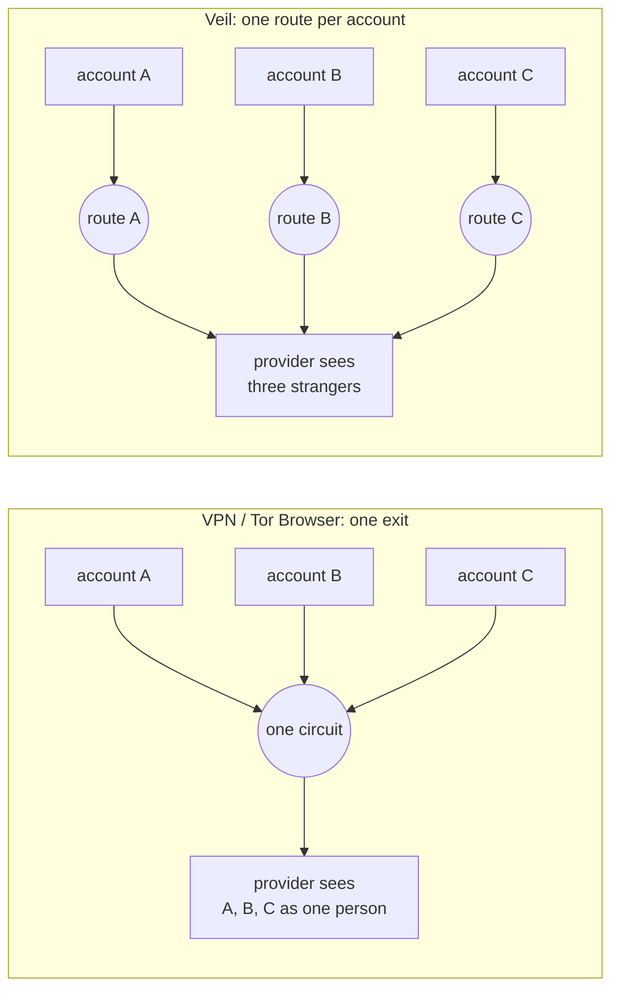
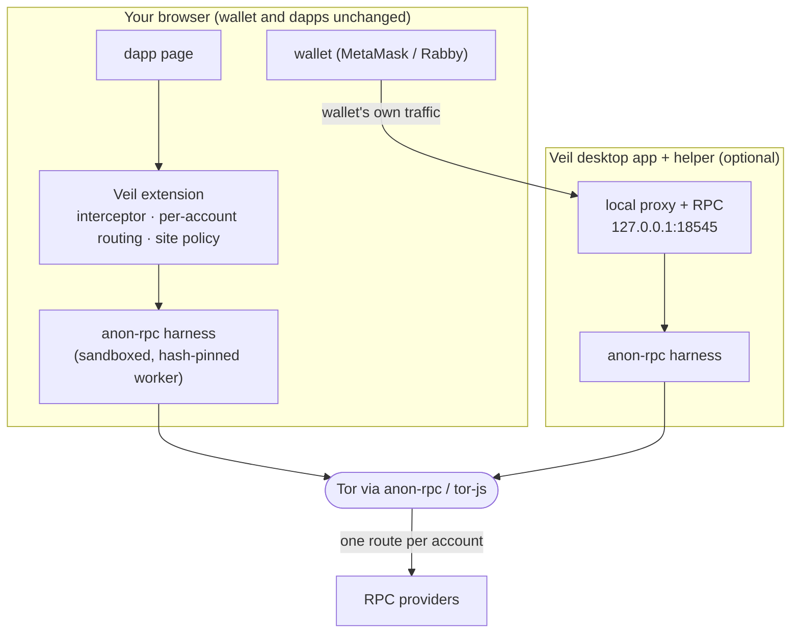
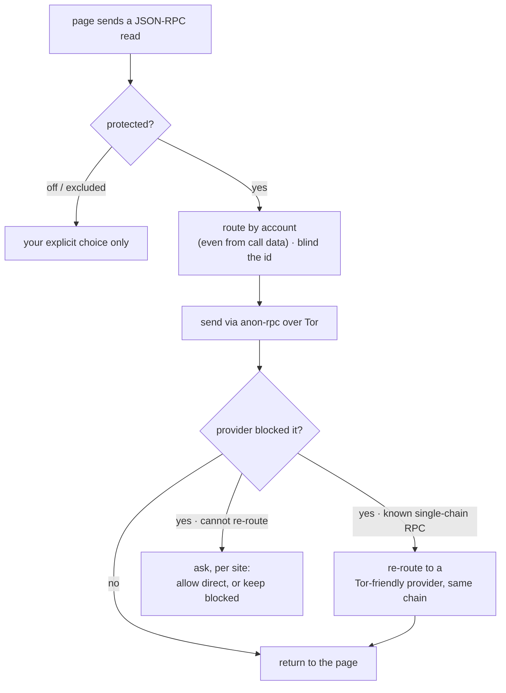

<div align="center">

# 🕶️ Veil

### Private by default for the wallets and dapps you already use.

Your crypto traffic leaves through **Tor** with **one route per account**, so the providers
your wallet and dapps talk to can't see your IP or tell your accounts apart. And when a
provider blocks Tor, Veil re-routes so your apps keep working.

Built on the Ethereum Foundation's **[anon-rpc](https://github.com/ethereum/anon-rpc)** and **[tor-js](https://github.com/ethereum/tor-js)**.

**🌐 [aman035.github.io/veil](https://aman035.github.io/veil/)** · _status: active development_

</div>

---

## 1. The problem

Wallets and dapps read mostly **straight from the page** to their data providers (Tenderly,
Alchemy, their own backends). Every read carries **your IP** and **the addresses you look up**.
A provider can tie your main wallet, trading wallet and airdrop wallets to **one person**, and
to **where you are**. That is how holders get de-anonymised, phished and physically targeted.

The usual fixes don't solve it:

- A **VPN** gives all your accounts one IP, so they still look like one person.
- **Tor Browser** gives the whole session one circuit, so accounts are still linked, and many
  providers block Tor outright (Aave's rejected 0 of 16 reads in our tests).



## 2. The solution

Veil makes the wallets and dapps you **already use** private, with no change to them.

- **One route per account.** Each account gets its own Tor circuit and exit (an anon-rpc
  isolation key), so a provider sees unrelated strangers instead of one person.
- **Re-routes around blocks.** When a provider refuses Tor, standard reads are re-sent through a
  Tor-friendly provider on the same chain, only after a real block, never blindly.
- **Never silently direct.** If a read can't be made private, Veil asks you, per site, before any
  direct connection.

It ships in two parts: a **browser extension** (Chrome / Brave) that makes every dapp read
private, and an optional **desktop app** that also covers the wallet's own traffic and local
tools like `cast`, and pairs with the extension.

**Honest about what it hides:**

| | Hidden from providers | Still visible |
|---|---|---|
| **Your IP** | yes, on dapp reads (and wallet traffic with the helper) | the Tor gateway sees you use Tor, not what for |
| **Accounts linked** | yes, one route per account for RPC traffic | wallets' own multi-account APIs still link them at the app layer |
| **Addresses you query** | no | providers see them; hiding that needs PIR, a separate problem |

## 3. How it works

The extension intercepts a dapp page's JSON-RPC reads, routes each to its account's Tor circuit
through the anon-rpc harness, and returns the answer. The anon-client code runs **hash-pinned
and sandboxed** (anon-rpc) with no access to your keys, DOM or cookies. The desktop app runs the
same harness for the wallet's own traffic and for local tools.



Three rules shape every request:



1. **One route per account.** The account is read from the request, even inside `eth_call` call
   data, and request ids are blinded so a counter can't stitch routes back together.
2. **Re-routes around blocks.** Only after a real block, and only for known single-chain RPCs, so
   it never blindly breaks a multichain gateway.
3. **Never silently direct.** Any read that can't be made private surfaces a per-site choice.

**Built on anon-rpc.** Veil routes its RPC reads through anon-rpc **by default**. The extension
runs [`@anon-rpc/browser-extension-harness`](https://www.npmjs.com/package/@anon-rpc/browser-extension-harness) and the helper runs [`@anon-rpc/browser-harness`](https://www.npmjs.com/package/@anon-rpc/browser-harness). With protection on, essentially all of a dapp page's JSON-RPC reads leave through
anon-rpc. We intentionally **don't hide which addresses you look up** (that needs PIR, a separate
problem), which is a stated trade-off, not a gap. Known gaps: Web-Worker `fetch` and WebSockets
aren't intercepted yet.

## 4. CROPS

_Censorship-resistant, Open-source, Private, Secure - the properties Veil is built to hold at once._

- **C - Censorship resistant.** There is **no Veil server in the path**. The extension, helper and
  gateway are all things you run; the Tor gateway is **self-hostable and swappable**, and the
  Tor-friendly provider list is user-editable. If our gateway or any provider disappears or
  refuses you, point at another, or run your own, in **one config line**; nothing we operate can
  cut you off. The anon-client worker is fetched at runtime but **hash-pinned on-chain** and
  verified before it runs, so no host can swap in different code.
- **O - Open source.** **MIT.** The extension, helper and app build and run from this repo alone
  (`pnpm install && node build.mjs`); no hidden service is required to use it.
- **P - Private.** RPC providers see the addresses you query but **not your IP**, and **cannot link
  your accounts** (one circuit each). The **gateway relays only encrypted bytes** and never sees
  your traffic or destination. **No analytics, no telemetry, no accounts.** The honest limits are
  in the table above.
- **S - Secure.** Veil **never touches your keys** - it routes reads only; your wallet signs. The
  anon-client runs in a **null-origin sandboxed iframe** with no access to keys, DOM or cookies.
  Settings stay on your device (`chrome.storage` / local app). Trust assumptions: the open-source
  code, the on-chain-hash-pinned worker, and one bootstrap RPC read for the anon-rpc specifier.

No third-party trackers or analytics ship in the client, and Veil handles no keys or personal
data; everything stays on your device.

## 5. Project structure and setting up locally

```
veil/
├── src/        browser extension (Chrome / Brave, MV3)
├── helper/     desktop helper (localhost RPC routed through the harness)
├── app/        desktop app (Tauri) that runs the helper and pairs the extension
└── site/       landing site (published to GitHub Pages)
```

Prereqs: Node 18+ and `pnpm`. The desktop app also needs Rust + Tauri; the real-Tor demo needs a tor-js gateway.

```bash
# 1) Browser extension
pnpm install
node build.mjs                 # -> dist/  (load unpacked at chrome://extensions)

# 2) Desktop helper (private localhost RPC for cast / scripts / wallets)
cd helper && pnpm install && node helper.mjs      # serves http://127.0.0.1:18545

# 3) Desktop app (optional): spawns the helper, shows status, pairs the extension
cd app/src-tauri && cargo tauri dev
```

**Real Tor via a self-hosted gateway.** The network is swappable (gateway and worker are config,
not code). Build [`tor-js-gateway`](https://github.com/ethereum/tor-js), run it, then build the extension against it:

```bash
VEIL_SPECIFIER=0x700dA3193D35fA54Cd3fBf29B66f2a2A0385659e \
VEIL_GATEWAYS='["127.0.0.1:12298:<your-gateway-certhash>"]' \
node build.mjs
```

Without a gateway, build with the `passthrough` specifier (`0x4fd77be300f31c5fe6ab266d35d27750a3478d27`,
empty gateways) for a deterministic, non-private plumbing demo.

## License

[MIT](LICENSE). Built on the Ethereum Foundation's
[anon-rpc](https://github.com/ethereum/anon-rpc) and [tor-js](https://github.com/ethereum/tor-js).
