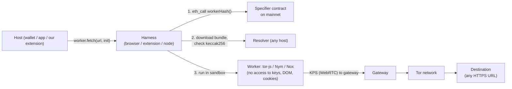

# Background: what you need to know before building

## anon-rpc in five minutes

anon-rpc (github.com/ethereum/anon-rpc, spec v0.4.0, Oct 2026) is the EF's standard for running an **anonymising network client** inside a wallet or app safely. It isn't a network itself.



- **The host gets one thing:** an anonymised `fetch`, which works for any HTTP(S) URL with tor-js, not just RPC.
- **Per-call options:** `anonOptions: { isolationKey }`. Calls with different keys are meant to be unlinkable. tor-js gives each key its own circuit and exit; **Nym ignores it**.
- **Only HTTP via fetch:** no WebSocket or raw sockets.
- **Trust:** the bootstrap RPC is trusted for one read (the specifier); the worker sees every request it carries.

## Packages and addresses

| Thing | Value |
|---|---|
| Browser harness | `@anon-rpc/browser-harness` (MIT) |
| Extension harness | `@anon-rpc/browser-extension-harness` (MV3: offscreen document on Chromium, background page on Firefox). Its README covers manifest entries and why remotely hosted, hash-pinned code is allowed |
| tor-js specifier (mainnet) | `0x700dA3193D35fA54Cd3fBf29B66f2a2A0385659e` |
| tor-js config (EF demo gateway) | `{ gateways: ["152.236.3.22:12298:uEiCH0VdbhryzJcMtCfB0vLA4sOvHdQ4hq5w7CopcwU59bQ"] }`; "limited capacity, may disappear" |
| Nym specifier (mainnet) | `0x3aCD9742C68F6d993066Ae25533e09b9e1f60eD0` (18 MB bundle; drops custom headers; no isolation) |
| Nox specifier (Sepolia) | `0x35133267A8F7EC35046a83DCA0f4Ca8A6e1b7A9A` |
| Passthrough (no privacy, testing) | `0x4fd77be300f31c5fe6ab266d35d27750a3478d27` |
| Bootstrap RPC used in tests | `https://ethereum-rpc.publicnode.com` (served Tor 12/12) |

Minimal use (tested in `experiments/kt-helper/helper-page.mjs`):

```ts
import { AnonRpcWorker } from "@anon-rpc/browser-harness";
const worker = new AnonRpcWorker({
  address: "0x700dA3193D35fA54Cd3fBf29B66f2a2A0385659e",
  config: { gateways: ["152.236.3.22:12298:uEiCH0VdbhryzJcMtCfB0vLA4sOvHdQ4hq5w7CopcwU59bQ"] },
  preExisting: { rpcProvider },   // EIP-1193-style, for the one specifier read
});
await worker.ready;               // ~15–20 s first time
const res = await worker.fetch(url, { method: "POST", body, anonOptions: { isolationKey: "acct-0x…" } });
```

## Ecosystem: what others are doing (don't duplicate)

| Who | What | Status |
|---|---|---|
| EF Reads team (reads.ethereum.foundation) | anon-rpc, tor-js, KPS, PIR (insPIRe on GPU), access-layer registry | Active; PIR production 2027 |
| Oblivious Labs | TEE+ORAM private state reads for Kohaku | Code public |
| Corpus (Colibri) | Verified reads over tor-js (EF grant) | Shipped `@corpus-core/colibri-tor` |
| Hisoka (Nox) | Sphinx mixnet + private tx relay as an anon-rpc worker | Sepolia; mainnet soon |
| "Lightfoot" (Mumbai team) | Colibri inside an anon-rpc worker | Plan published |
| Privacy Pools, Kiwi News | Integrate anon-rpc directly (opt-in, tor-js) | Live |
| Ambire | anon-rpc integration PR | Open |

**What nobody ships:** a drop-in layer that makes *unmodified* wallets and dapps private, with per-account routes and fallback around providers that block Tor. That's this project.

## Known user complaints we address (Privacy Pools PR #33, anon-rpc issue #10)
- One route per page linked identities; per-identity routes fixed it.
- Relayers and some APIs return 403 to Tor exits.
- Third-party SDKs bypass the tunnel.
- Isolation keys that are too fine-grained (one per request) cause slow tails; one per account costs about the same as a shared circuit.

## Reading list
- Spec: https://github.com/ethereum/anon-rpc/blob/main/SPEC.md
- Wallet guide: https://ethereum.github.io/anon-rpc/wallets/
- Extension harness: https://github.com/ethereum/anon-rpc/tree/main/impl/browser-extension-harness
- Issue #10 (isolation keys, wallet experience): https://github.com/ethereum/anon-rpc/issues/10
- tor-js: https://github.com/ethereum/tor-js
- Threat map (personal notes by the EF Reads lead): https://github.com/andyguzmaneth/anon-rpc-threat-map
