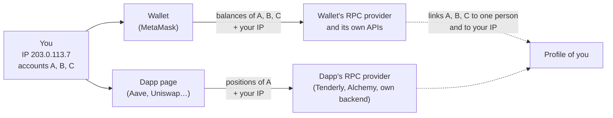
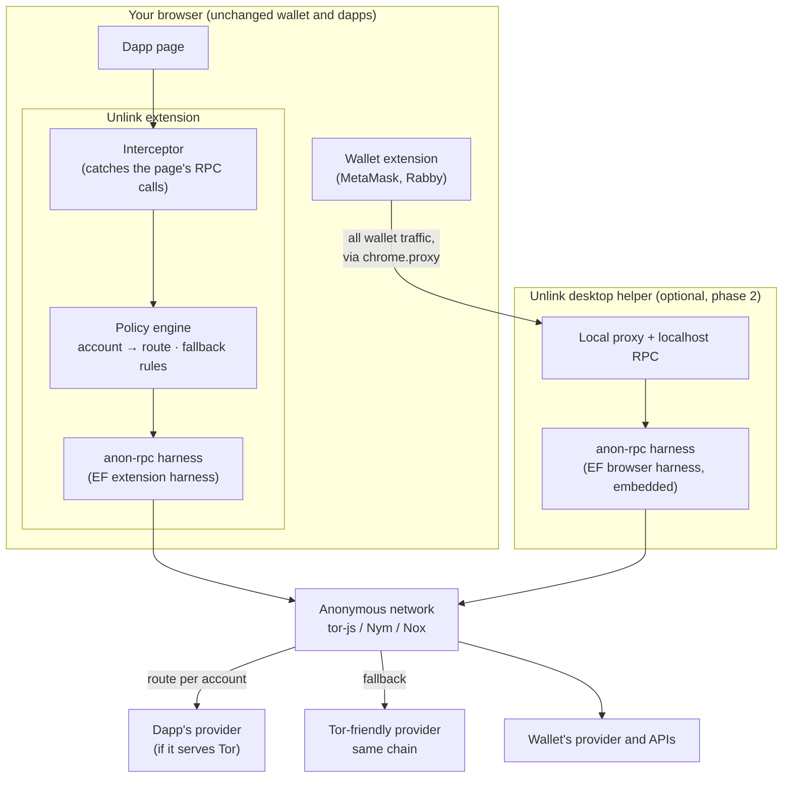
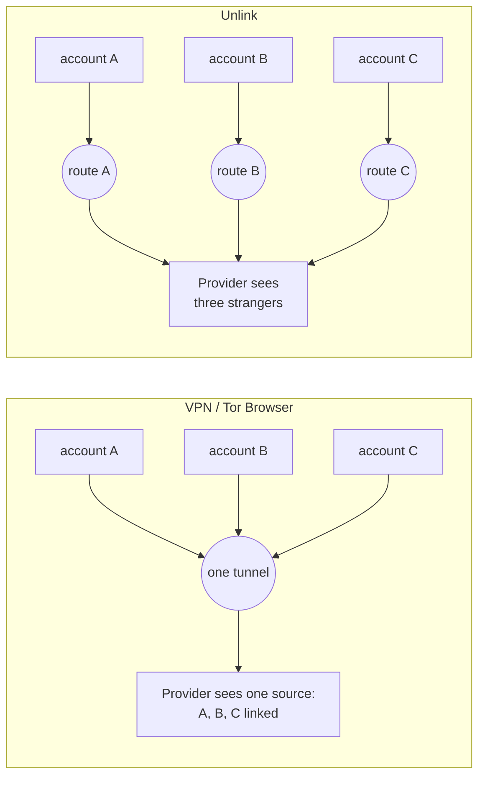
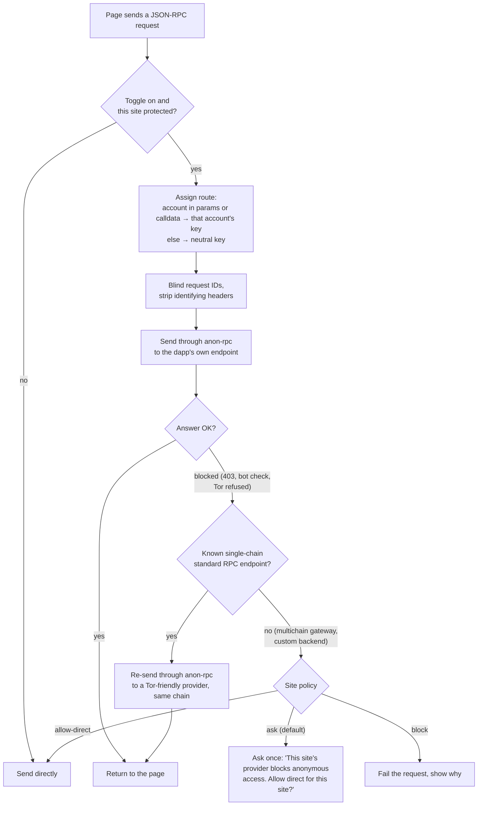
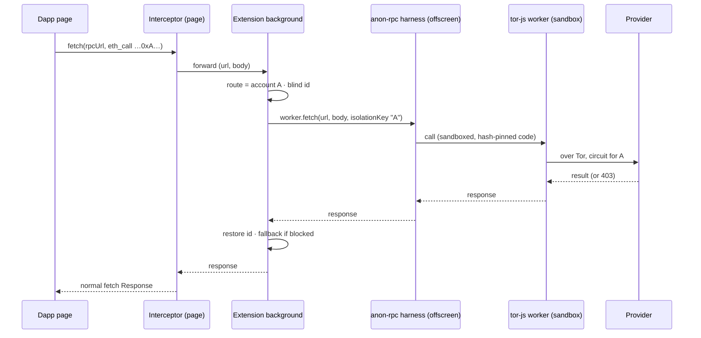
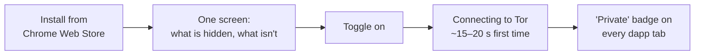

# Unlink: PRD

**Working name.** Private by default for the wallets and dapps you already use.

| | |
|---|---|
| Status | Approved, 6 Nov 2026. Building Phase 0 (kill tests), then Phase 1 (extension MVP) |
| Owner | Aman |
| Built on | EF anon-rpc (sandboxed, hash-pinned network clients) and tor-js |
| Evidence | Every claim marked *(measured)* is in [`evidence.md`](evidence.md) |

---

## 1. One-line summary

A browser extension, plus an optional desktop helper, that routes your crypto app traffic through anonymous networks. It gives **each of your accounts its own route**, so the providers your wallet and dapps talk to can't see your IP or tell that your accounts belong to the same person. It keeps dapps working even when their providers block anonymous traffic.

---

## 2. The problem

### 2.1 What happens today when you open a dapp



Every request carries **your IP and the addresses you look up**. Providers can link all your accounts together and tie them to where you are. That's how wallets get de-anonymised, phished and targeted ("$5 wrench attacks"). The leak isn't only to your wallet's provider: **dapps call providers directly from the page**. On 10 large dapps, nearly all reads went straight from the page to the dapp's own provider, not through the wallet *(measured)*.

### 2.2 Why existing fixes don't solve it

| Fix | Hides your IP | Stops your accounts being linked | Keeps dapps working | Needs nothing from the app |
|---|---|---|---|---|
| Nothing | ❌ | ❌ | ✅ | ✅ |
| VPN | ✅ (from the provider; the VPN company sees it) | ❌ one tunnel = one IP for all accounts | ✅ | ✅ |
| Tor Browser / Orbot | ✅ | ❌ one circuit for the session | ❌ **Aave: 0/16 RPC calls succeed over Tor** *(measured)* | ✅ |
| anon-rpc, integrated by an app | ✅ | ✅ (isolation keys) | depends on the app | ❌ each app must integrate it; only 2 apps have, both opt-in |
| **Unlink** | ✅ | ✅ one route per account | ✅ re-routes around providers that block Tor | ✅ |

### 2.3 Three facts that shape the product *(all measured)*

1. **Dapps read directly, not through the wallet.** Covering the wallet alone misses most of the leak.
2. **Major providers block anonymous traffic.** Aave's provider (Tenderly) rejects Tor; 1inch's endpoint returns a bot-check page. Only 10 of 24 free public RPCs serve Tor well. A plain "route over Tor" tool breaks Aave.
3. **Wallets link your accounts themselves.** MetaMask's balance service takes all your accounts in one request, and it talks to 20+ of its own API hosts beyond the RPC.

---

## 3. Users

| Who | What they want | Why they'd install this |
|---|---|---|
| **Multi-account holders** (main wallet, trading wallet, airdrop wallets) | Keep accounts separate | Today every provider links them; a VPN doesn't help |
| **High-value holders, DAO signers, treasury operators** | Not be identifiable or locatable | Physical and phishing risk; their addresses are public |
| **Privacy-minded everyday users** | "Turn privacy on" without learning Tor | One toggle; dapps keep working |
| **Developers and bots** (`cast`, scripts) | Private reads from tools | Localhost endpoint through the desktop helper |

**Primary user for the MVP:** desktop Chrome or Brave users with MetaMask or Rabby and several accounts, who use mainstream DeFi.

---

## 4. Goals and non-goals

**Goals**
- G1. With the toggle on, dapp pages' RPC reads leave through an anonymous network, **one route per account**.
- G2. Dapps keep working: if a provider blocks anonymous traffic, standard RPC calls are re-routed to a provider that serves it.
- G3. With the desktop helper, the wallet's own traffic (RPC and its APIs) also leaves anonymously.
- G4. The user can always see what is protected, what isn't, and why. No silent fallback to direct connections.
- G5. Built on anon-rpc as the EF designed it: hash-pinned, sandboxed network clients, so the network code is auditable and swappable (Tor, Nym, Nox).

**Non-goals (for now)**
- Hiding *what* you look up. Providers still see the addresses queried (PIR and oblivious servers are other projects).
- A system-wide VPN for all apps.
- Mobile.
- Private transaction sending beyond a separate route per send (no mixnet delays in MVP).
- Fixing wallets' own account-linking APIs: we hide the IP on them, but MetaMask's balance service still sees your accounts together (see §8).

---

## 5. The solution

### 5.1 The shape



**Two parts, shipped in order:**
1. **Extension (MVP).** Protects every dapp's own reads. One-click install, no permissions beyond the browser.
2. **Desktop helper (phase 2).** Protects the wallet's traffic and local tools. The extension points the browser's proxy setting for wallet and crypto hosts at it *(measured: `chrome.proxy` routes other extensions' traffic)*.

### 5.2 One route per account: the core idea



Each request is assigned to an account by the addresses it mentions, and each account gets its own anon-rpc **isolation key**: its own Tor circuit and exit. Requests that mention no account share one neutral route. Request IDs are randomised so a counter can't link routes back together (viem uses one global counter).

### 5.3 How a request is routed



Re-routing happens **only after a block**, and only for endpoints we know are standard single-chain RPCs. Blind re-routing broke Uniswap (0/33), because its gateway isn't a plain mainnet RPC; re-routing after a block fixed Aave (0/16 → 3/3) *(measured)*.

### 5.4 One request, end to end



---

## 6. Product experience

### 6.1 Install and first run (under one minute)



### 6.2 The popup (the only UI most people see)

```
┌──────────────────────────────────────────┐
│  Unlink                      [ ON  ●]    │
│  Private · Tor                           │
├──────────────────────────────────────────┤
│  This tab: app.aave.com                  │
│  27 requests protected                   │
│  3 accounts on 3 separate routes         │
│  Provider blocks Tor → re-routed (safe)  │
├──────────────────────────────────────────┤
│  Today: 1,284 requests · 9 sites         │
│  Not covered: wallet's own traffic       │
│  → Install the desktop helper            │
├──────────────────────────────────────────┤
│  Still visible to providers:             │
│  the addresses you look up.              │
└──────────────────────────────────────────┘
```

### 6.3 Moments that are designed, not left to errors

| Moment | What the user sees |
|---|---|
| Tor starting | "Connecting privately… about 20 s the first time." Requests wait; nothing leaks while it connects. |
| A provider blocks Tor and can be re-routed | Nothing: it just works. The popup notes "re-routed". |
| A provider blocks Tor and can't be re-routed | One clear choice per site: allow direct for this site, or keep blocked. Never silent. |
| Tor down | Badge turns amber: "Paused: not private". A choice to wait or go direct; nothing goes direct automatically. |
| Slow site | Reads take ~1.5–3 s over Tor *(measured)*. Cache safe reads per block to keep pages usable. |

---

## 7. Requirements

### 7.1 Extension MVP (P0)

| # | Requirement | Acceptance |
|---|---|---|
| E1 | Catch JSON-RPC `fetch` and XHR from dapp pages (main thread) | viem, ethers v5 and v6 and raw XHR caught *(measured)* |
| E2 | Run tor-js through the EF extension harness (offscreen document) | `worker.ready` resolves; balance read works |
| E3 | One isolation key per account; neutral key otherwise; ignore the zero address; learn the user's addresses from balance and nonce queries and match them inside calldata | Unit tests on real dapp request logs |
| E4 | Blind JSON-RPC ids; strip identifying headers | No caller id or counter on the wire |
| E5 | Fallback re-routing only after a block, only for known single-chain endpoints | Aave works; Uniswap not broken |
| E6 | Per-site policy: ask, block or allow-direct; no silent direct fallback | Manual and e2e tests |
| E7 | Popup: status, per-tab counts, routes, re-routes, what isn't covered | Screenshot review |
| E8 | No telemetry, no remote config; network code only from hash-pinned specifiers | Code review |

### 7.2 Desktop helper (P1, phase 2)

| # | Requirement |
|---|---|
| D1 | Embedded browser engine running the EF browser harness (the EF Node harness can't run tor-js: no WebAssembly) *(measured)* |
| D2 | Local proxy target for `chrome.proxy`, covering wallet RPC and crypto API hosts |
| D3 | Localhost JSON-RPC endpoint for wallets' custom RPC and tools (`cast`), with per-account routing *(measured working with `cast`)* |
| D4 | HTTPS handling: tunnel non-RPC hosts as-is (IP hidden); per-account splitting only where requests can be read |

### 7.3 Non-functional

- **Latency:** 1.5–3.5 s per uncached read over Tor is acceptable for reads; cache per block where safe.
- **Fail closed:** any failure surfaces to the user; nothing goes direct without the site policy allowing it.
- **Privacy of the product itself:** no analytics, no accounts, no server of ours in the path except a Tor-friendly RPC list.
- **Licences:** MIT or Apache dependencies only.

---

## 8. What it hides, and what it doesn't

| | Hidden from providers | Still visible |
|---|---|---|
| Your IP | ✅ (dapp reads in MVP; wallet traffic with the helper) | to the Tor gateway (it sees that you use Tor, not what for) |
| That your accounts belong together | ✅ for RPC traffic | ❌ to wallets' own services that take all accounts in one request (e.g. MetaMask's balance API) |
| Which addresses you look up | ❌ | providers see them; needs PIR (not this product) |
| Timing | partly (separate routes) | request timing is not padded in MVP |
| Correctness of answers | ❌ not verified in MVP | a provider could lie, as today |
| Transactions you send | the IP is hidden when sent through a route | the transaction is public by nature |

---

## 9. Phases

```mermaid
gantt
    title Plan (weeks)
    dateFormat X
    axisFormat %s
    section Phase 0
    Remaining kill tests            :0, 1
    section Phase 1 Extension MVP
    Interceptor + harness + routing :1, 3
    Fallback + site policy          :2, 4
    Popup + onboarding              :3, 5
    section Phase 2 Desktop helper
    Embedded harness + local proxy  :5, 8
    Localhost RPC + tools           :7, 9
    section Phase 3 Launch
    Hardening, store review, docs   :9, 12
```



**Phase 0: remaining kill tests (week 1)**
1. The EF extension harness inside *our* extension, with tor-js: ready time, and that it coexists with MetaMask.
2. Fallback logic against Aave, Uniswap and 1inch in a real browser with a real wallet.
3. The account-mapping heuristic against recorded traffic from 10 dapps (false links and missed links).
4. Chrome Web Store policy check for remotely loaded, hash-pinned code. The EF extension harness README argues it's allowed; confirm.

---

## 10. Success metrics

| Metric | Target for MVP |
|---|---|
| Dapps that keep working with the toggle on (top 20 DeFi) | ≥ 18/20 |
| Share of a dapp page's JSON-RPC calls that leave anonymously | ≥ 95% |
| Accounts linkable by a provider in our test (5 accounts, 3 dapps) | 0 via RPC traffic |
| Median added latency per read | ≤ 2.5 s uncached |
| Silent direct fallbacks | 0 |

---

## 11. Risks

| Risk | Signal | Response |
|---|---|---|
| More providers block Tor | Fallback rate rises | Grow the Tor-friendly provider list; later, a paid anonymous gateway (stake-to-read) |
| Free Tor-friendly RPCs shut down | List shrinks | Same as above |
| Account mapping links wrong accounts | Tests on recorded traffic | Conservative mapping; when unsure, use a fresh route |
| EF demo gateway (tor-js) goes away | Bootstrap failures | Config for alternative gateways; Nym as a second network |
| Chrome Web Store rejects remote code | Review | Harness verifies hash before running; argue it as the EF README does; Firefox as fallback |
| Slow pages | Complaints | Per-block caching; let users exclude sites |
| Overclaiming privacy | Any copy | §8 table shown in onboarding and the popup |

---

## 12. Open questions

1. Name.
2. Default site policy when re-routing isn't possible: ask, or block?
3. Which Tor-friendly providers to ship with, and how users can add their own.
4. Ship Nym as an option in MVP, given it ignores isolation keys *(measured)*?
5. Firefox in MVP or later?
6. Should the helper fan out wallet APIs that take many accounts (e.g. MetaMask's multi-account balances) into one request per account? It's fragile, but the only way to unlink those.
